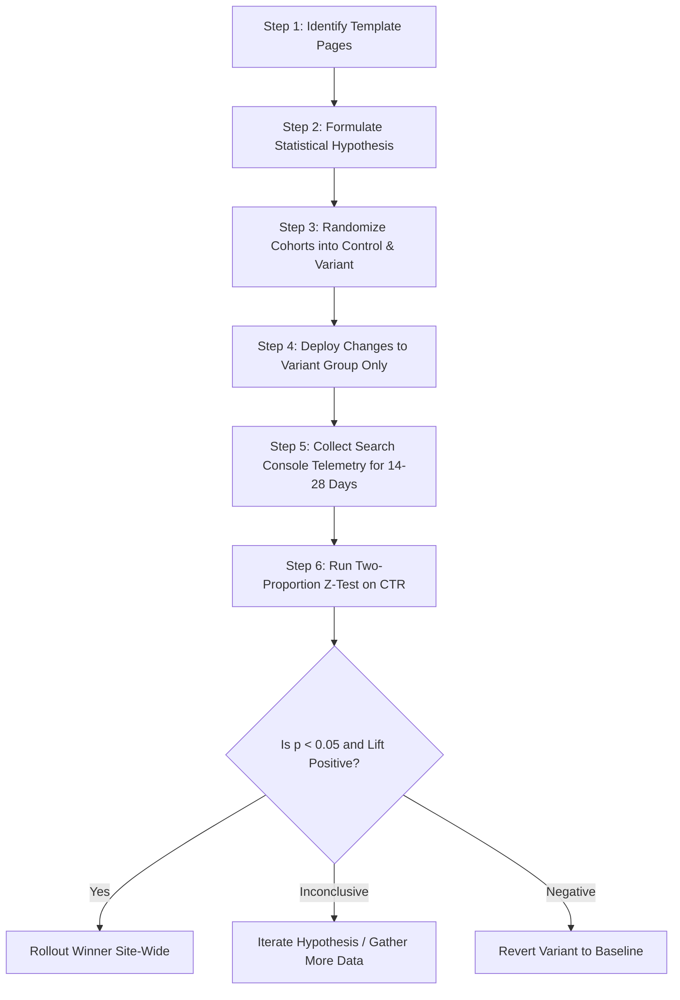

# PILLAR BLOG POST & ON-PAGE SEO SPECIFICATION

**Target URL:** `/guides/seo-split-testing/`  
**Primary Keyword:** `seo split testing`  
**Secondary Keywords:** `seo a/b testing`, `how to test seo changes`, `seo split test vs cro`, `title tag a/b test`  
**Search Intent:** Informational Pillar  
**Target Word Count:** ~2,600 Words  

---

## 1. On-Page Metadata & Structured Data

```html
<!-- Rank Math / Yoast SEO Fields -->
<title>The Definitive Guide to SEO Split Testing: How to Test Changes Scientifically</title>
<meta name="description" content="Master SEO split testing without expensive enterprise software. Learn how to divide pages into control and variant groups, run two-proportion z-tests, and prove ROI." />
<link rel="canonical" href="https://YOURDOMAIN.COM/guides/seo-split-testing/" />

<!-- OpenGraph Social Tags -->
<meta property="og:type" content="article" />
<meta property="og:title" content="The Definitive Guide to SEO Split Testing: Empirical Optimization" />
<meta property="og:description" content="Discover how to run real SEO A/B split tests on WordPress and custom sites. Mathematical formulas, control groups, and statistical confidence explained." />
<meta property="og:url" content="https://YOURDOMAIN.COM/guides/seo-split-testing/" />
<meta property="og:image" content="https://YOURDOMAIN.COM/wp-content/uploads/seo-split-testing-guide-banner.png" />
<meta name="article:published_time" content="2026-10-10T08:00:00+00:00" />
<meta name="article:author" content="SEO Experiment Lab Research Team" />
```

### Structured Data: TechArticle & FAQPage JSON-LD Schema
```html
<script type="application/ld+json">
{
  "@context": "https://schema.org",
  "@graph": [
    {
      "@type": "TechArticle",
      "headline": "The Definitive Guide to SEO Split Testing: How to Test On-Page Changes Scientifically",
      "description": "A comprehensive guide to conducting controlled SEO split tests, isolating causal ranking factors, and verifying statistical significance using two-proportion z-tests.",
      "author": {
        "@type": "Organization",
        "name": "SEO Experiment Lab"
      },
      "publisher": {
        "@type": "Organization",
        "name": "SEO Experiment Lab",
        "url": "https://YOURDOMAIN.COM/"
      },
      "datePublished": "2026-10-10",
      "inLanguage": "en"
    },
    {
      "@type": "FAQPage",
      "mainEntity": [
        {
          "@type": "Question",
          "name": "What is the difference between SEO testing and CRO testing?",
          "acceptedAnswer": {
            "@type": "Answer",
            "text": "CRO testing splits human visitors across different versions of the same URL to measure conversion rates. In contrast, SEO split testing divides groups of similar pages into control and variant groups to measure how search engine crawlers rank and click each group, avoiding cloaking penalties."
          }
        },
        {
          "@type": "Question",
          "name": "How does SEO split testing work without cloaking?",
          "acceptedAnswer": {
            "@type": "Answer",
            "text": "SEO split testing avoids cloaking by never serving different content to bots versus humans on the same page. Instead, it tests page groups: one cohort of URLs receives the change for both bots and humans, while an equivalent cohort remains unchanged as a baseline control."
          }
        },
        {
          "@type": "Question",
          "name": "How long should an SEO split test run?",
          "acceptedAnswer": {
            "@type": "Answer",
            "text": "An SEO test should run for a minimum of 14 to 28 days. This duration ensures sufficient impressions and clicks accumulate for statistical significance while normalizing day-of-week seasonality."
          }
        },
        {
          "@type": "Question",
          "name": "What sample size is required for an SEO A/B test?",
          "acceptedAnswer": {
            "@type": "Answer",
            "text": "A reliable test typically requires at least 10,000 to 25,000 impressions per cohort (control and variant) to detect realistic CTR changes of 10% to 20% at a 95% confidence level."
          }
        }
      ]
    }
  ]
}
</script>
```

---

## 2. Full Article Copy (Paste into WordPress Gutenberg Block Editor)

# The Definitive Guide to SEO Split Testing: How to Test On-Page Changes Scientifically

Every week, thousands of website owners update their page titles, rewrite meta descriptions, and adjust header tags based on what an influencer or software audit suggested. Three weeks later, organic traffic increases by 8%, and the team celebrates a successful optimization.

Yet, a critical question remains: **Did the title change actually cause the traffic increase?**

Or did Google roll out a core update that penalized a competitor? Did consumer search demand naturally increase due to seasonal buying cycles? Or did search volume spike due to unrelated industry news?

In modern search engine optimization, relying on simple before-and-after observations is dangerous. To truly understand which optimizations drive growth, you need **SEO split testing**.

In this comprehensive guide, we examine the mechanics of page-bucket testing, review the mathematical principles behind statistical significance, explore how to test without cloaking penalties, and demonstrate practical execution for WordPress and custom websites.

---

## What is SEO Split Testing?

> **Definition:** **SEO split testing** (also referred to as *SEO A/B testing*) is a scientific methodology used to isolate the causal impact of website changes on organic search performance by comparing a variant cohort of pages against an unchanged control cohort of similar pages over the exact same time window.

Unlike standard digital marketing optimizations that rely on intuition or correlative benchmarks, SEO split testing isolates variables to prove causation.

### SEO Testing vs. CRO Testing: Understanding the Crucial Difference

Many marketers confuse **SEO split testing** with **Conversion Rate Optimization (CRO) A/B testing**. While both use statistical comparisons, their architectural mechanisms are opposites:

| Dimension | CRO A/B Testing (e.g., VWO, Optimizely) | SEO Split Testing (e.g., SEO Experiment Lab) |
|---|---|---|
| **What is Split?** | **Users / Human Visitors** | **Pages / URLs** |
| **Execution Layer** | Client-side JavaScript or Edge redirect on 1 URL | Server-side HTML on distinct cohorts of URLs |
| **Primary Metric** | Conversion Rate (Purchases, Sign-ups, Clicks) | Search Visibility (Clicks, Impressions, CTR, Rank) |
| **Target Evaluator** | Human Users interacting with the page | Search Engine Web Crawlers (Googlebot, Bingbot) |
| **Search Engine Risk** | **High Risk:** Cloaking penalties if bots see different content than users | **Zero Risk:** Bots and users see identical content on each individual URL |

According to official [Google Search Central documentation on testing](https://developers.google.com/search/docs/crawling-indexing/testing-sites-for-google-search), serving different content to search engine bots than to human users violates Google's Webmaster Guidelines under the **cloaking policy**. 

SEO split testing avoids cloaking entirely because **every URL serves the exact same content to both Googlebot and human visitors**. The split occurs across *different URLs within the same template*.

---

## Why "Before-and-After" SEO Analysis is Flawed

The vast majority of digital marketers practice "time-based testing":
1. Measure baseline performance for 30 days.
2. Change the title tag on day 31.
3. Measure performance for the next 30 days.
4. Attribute any difference to the change.

In statistics, this is known as the *post hoc ergo propter hoc* fallacy ("after this, therefore because of this"). 

```
Timeline:  [ Day 1 - 30: Baseline ] ──> [ Day 31: Update Made ] ──> [ Day 32 - 60: Post-Period ]
Confounders:       Google Core Update?     Seasonality?     Competitor Lost Rankings?
```

Time-based analysis fails because search engine performance is subject to severe confounding variables:
- **Seasonality:** Search volume for B2B queries drops during holidays; eCommerce queries spike during Q4.
- **Algorithm Updates:** Google rolls out thousands of search tweaks and multiple Core Algorithm Updates every year.
- **SERP Layout Changes:** Google frequently tests AI Overviews, Local Packs, and PAA widgets that alter organic CTR independently of your rankings.

**Cohort split testing solves this problem entirely.** Because both the control group and the variant group run during the *same time window*, any external disruption affects both groups equally. If the variant group outperforms the control group by a statistically significant margin, you have empirical proof of causation.

---

## What On-Page Elements Can You Test?

You can test virtually any element that influences search engine crawling, indexation, or user click behavior:

### 1. Title Tags (Highest Impact Vector)
Your `<title>` tag is both a direct ranking factor and your primary advertisement in search results. Common tests include:
- **Formula Testing:** `[Keyword] - Brand` vs. `[Keyword] | Benefit Hook - Brand`
- **Number Inclusion:** Adding current years, lists, or quantitative metrics (e.g., *"10 Best Courses"* vs. *"Best Courses"*).
- **Intent Alignment:** Adding transactional modifiers (*"Free"*, *"Download"*, *"Reviews"*).

### 2. Meta Descriptions (CTR Optimization)
While meta descriptions are not a direct ranking factor, they directly determine search snippet Click-Through Rate (CTR).
- Testing benefit-driven hooks versus informative summaries.
- Adding specific calls to action (CTAs).
- Testing dynamic pricing or delivery promises (*"Free 2-Day Shipping"*).

### 3. Headings (H1, H2, H3)
- Testing whether incorporating secondary and long-tail keywords into subheadings improves secondary keyword rankings.
- Structuring headings into question formats to capture **People Also Ask (PAA)** snippets.

### 4. Content Depth & Structured Data
- Adding structured FAQ accordions backed by `FAQPage` JSON-LD schema.
- Comparing short-form versus comprehensive technical breakdowns across category templates.

---

## Step-by-Step Methodology: How to Run an SEO Split Test



### Step 1: Identify Suitable Template Pages
To run an SEO split test, your site must contain a cluster of pages that share the same template and search intent. Excellent candidates include:
- Blog post templates (`/blog/*`)
- eCommerce product pages (`/product/*`)
- Category pages (`/category/*`)
- City landing pages (`/locations/*`)

**Volume Requirement:** Both groups combined should generate at least 15,000 to 30,000 monthly impressions to ensure statistical power.

### Step 2: Formulate an Empirical Hypothesis
A scientific test requires a falsifiable hypothesis with a defined metric and target lift:

> *"Changing category page titles from '[Category Name] | Brand' to '[Category Name]: Up to 40% Off & Free Shipping' will increase organic CTR from 3.0% to 3.5% over 21 days."*

- **Null Hypothesis (\(H_0\)):** The title change has no effect on CTR (\(p_{\text{variant}} = p_{\text{control}}\)).
- **Alternative Hypothesis (\(H_1\)):** The title change significantly alters CTR (\(p_{\text{variant}} \ne p_{\text{control}}\)).

### Step 3: Bucketize Pages into Control and Variant
Export your URLs from Google Search Console. Pair pages by historical traffic volume and impressions, then randomly assign one from each pair to the **Control group** and the other to the **Variant group**. 

This pairing ensures that high-traffic outlier pages do not skew the baseline.

### Step 4: Deploy Changes to the Variant Group Only
Apply your title or meta tag changes *only* to the URLs in the Variant cohort. Keep the Control cohort strictly untouched.

### Step 5: Gather Search Performance Data (14–28 Days)
Allow Googlebot sufficient time to re-crawl and re-index the variant pages. Extract daily Impressions and Clicks for both groups from Google Search Console or your automated dashboard.

---

## The Mathematics of SEO Significance: The Two-Proportion Z-Test

When evaluating click-through rates, you cannot simply look at raw percentages. If your control group had a 3.1% CTR and your variant group had a 3.4% CTR, was that a real optimization victory, or merely random variation?

To determine significance, we calculate the **Two-Proportion Z-Test**.

### The Mathematical Formula

The standard test statistic \(Z\) is computed as:

$$Z = \frac{p_2 - p_1}{\text{SE}}$$

Where:
- \(p_1 = \frac{\text{clicks}_1}{\text{impressions}_1}\) (Control CTR)
- \(p_2 = \frac{\text{clicks}_2}{\text{impressions}_2}\) (Variant CTR)
- \(\text{SE}\) is the pooled standard error:

$$\text{SE} = \sqrt{p_{\text{pool}} (1 - p_{\text{pool}}) \left(\frac{1}{n_1} + \frac{1}{n_2}\right)}$$

And the pooled proportion \(p_{\text{pool}}\) is:

$$p_{\text{pool}} = \frac{\text{clicks}_1 + \text{clicks}_2}{\text{impressions}_1 + \text{impressions}_2}$$

### Interpreting the Results
- **Significance Level (\(\alpha\)):** The standard academic benchmark is \(\alpha = 0.05\) (95% confidence).
- **Critical Threshold:** For a two-tailed test at 95% confidence, if \(|Z| \ge 1.96\) (corresponding to \(p < 0.05\)), we reject the null hypothesis and conclude that the difference is statistically significant.
- **Winning Rule:** If \(p < 0.05\) and \(Z > 0\), the variant is a verified winner!

> **Try It Yourself:** You don't have to calculate standard errors manually. Use our free, embeddable **[Two-Proportion Z-Test SEO Significance Calculator](/tools/seo-significance-calculator/)** to calculate your p-values and confidence intervals instantly.

---

## Common Pitfalls in SEO Testing & How to Avoid Them

### 1. Stopping the Test Too Early (Peeking Problem)
Testing platforms sometimes show a "+25% CTR" on day three. Checking results prematurely and halting tests early drastically inflates false positives (Type I error). Always commit to a pre-determined duration (minimum 14 full days).

### 2. Testing Low-Traffic Pages
If your variant pages only receive 200 total impressions per week, a two-proportion test will almost never reach statistical significance because the sample size lacks statistical power. Focus tests on your highest-traffic templates.

### 3. Modifying Multiple Variables Simultaneously
If you rewrite the title tag, change the H1, add 500 words of content, and compress images all on the same day, you cannot know which change drove the result. **Test one variable at a time.**

---

## Frequently Asked Questions (FAQ)

### What is the difference between SEO testing and CRO testing?
CRO testing splits human visitors across different versions of the same URL to measure conversion rates. In contrast, SEO split testing divides groups of similar pages into control and variant groups to measure how search engine crawlers rank and click each group, avoiding cloaking penalties.

### How does SEO split testing work without cloaking?
SEO split testing avoids cloaking by never serving different content to bots versus humans on the same page. Instead, it tests page groups: one cohort of URLs receives the change for both bots and humans, while an equivalent cohort remains unchanged as a baseline control.

### How long should an SEO split test run?
An SEO test should run for a minimum of 14 to 28 days. This duration ensures sufficient impressions and clicks accumulate for statistical significance while normalizing day-of-week seasonality.

### What sample size is required for an SEO A/B test?
A reliable test typically requires at least 10,000 to 25,000 impressions per cohort (control and variant) to detect realistic CTR changes of 10% to 20% at a 95% confidence level.

---

## Conclusion & Next Steps

Search engine optimization is transitioning from an era of guesswork into an era of empirical science. By adopting structured SEO split testing, you protect your website against harmful changes and build an evidence-backed optimization roadmap that leadership and clients can trust.

Ready to run your first test?
- Compute your test significance using our **[SEO Significance Calculator](/tools/seo-significance-calculator/)**.
- Learn how to configure test templates in our **[WordPress SEO Testing Tutorial](/tutorials/wordpress-seo-testing/)**.
- Learn more about our academic research on our **[About Us Page](/about/)**.
